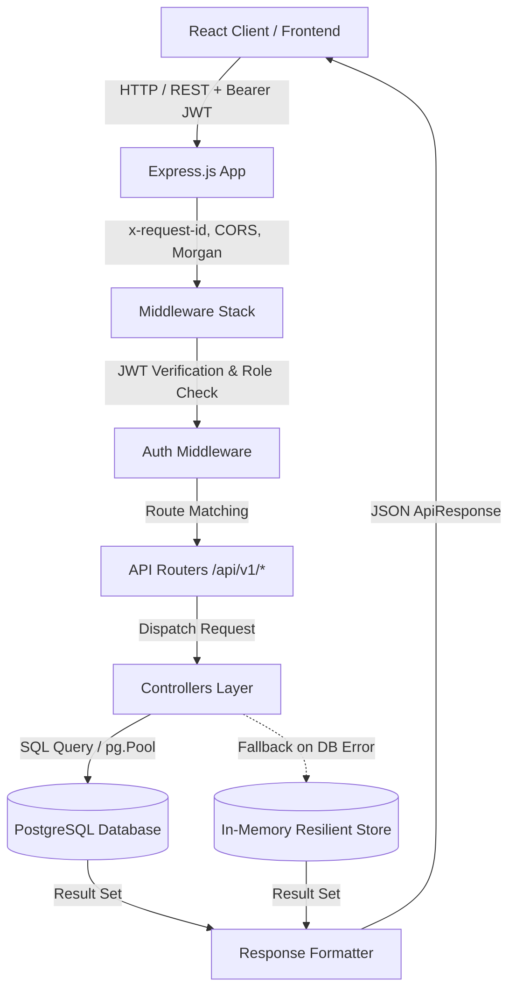

# Fairway CRM - Backend Architecture, Database Schema & API Reference Documentation

This document provides a comprehensive technical overview of the Fairway CRM backend architecture, database storage mechanism, table structures, relationship models, and API endpoints.

---

## 1. System Architecture Overview

Fairway CRM backend is built as a robust, production-ready RESTful service using **Node.js, Express, TypeScript, and PostgreSQL**. It is architected for high reliability, fast response times, and resilient operation with a built-in Dual-Engine Persistence strategy.



### Core Technologies
- **Runtime Environment:** Node.js (v18+) with ES Modules (`"type": "module"`)
- **Web Framework:** Express.js 4.x
- **Language:** TypeScript with strict type checking
- **Database:** PostgreSQL with `pg` (node-postgres) Connection Pool
- **Authentication:** Stateless JWT (JSON Web Tokens) with PBKDF2/Bcrypt password hashing
- **Dual-Engine Architecture:** PostgreSQL Primary Storage with automatic graceful fallback to an in-memory data store to guarantee zero downtime during database cold starts or maintenance.

---

## 2. Database Connection & Auto-Initialization

The database lifecycle is managed inside [`backend/src/config/db.ts`](file:///e:/personal/fireway-demo/backend/src/config/db.ts).

### Automatic Database Creation
When the backend boots up:
1. **Maintenance Client:** It first connects to PostgreSQL's default `postgres` maintenance database via `ensureDatabaseExists('fairway_crm')`.
2. **Existence Verification:** Queries `SELECT 1 FROM pg_database WHERE datname = 'fairway_crm'`.
3. **Auto Creation:** If the database does not exist, it runs `CREATE DATABASE "fairway_crm";` automatically.

### Connection Pool Configuration
```typescript
export const pool = new Pool({
  connectionString: config.databaseUrl,
  ssl: process.env.NODE_ENV === 'production' ? { rejectUnauthorized: false } : false,
});
```

### Auto-Migration & Schema Sync
When `initDatabase()` is called on startup:
- Tables are verified and created using `CREATE TABLE IF NOT EXISTS`.
- Column additions and type adjustments use idempotent `ALTER TABLE ... ADD COLUMN IF NOT EXISTS` and `ALTER TABLE ... ALTER COLUMN TYPE ...`.
- Automatic seeding verifies if tables are empty, and if so, seeds default roles, permissions, administrative users, sample companies, inquiries, properties, and proposals.

---

## 3. Database Schema & Tables (17 Master Tables)

The Fairway CRM database model consists of **17 relational tables** covering enterprise real estate leasing workflows.

### 3.1. `users` Table
Stores staff accounts, brokers, leasing managers, and executives.

| Column | Type | Constraints | Description |
| :--- | :--- | :--- | :--- |
| `id` | `VARCHAR(255)` | `PRIMARY KEY` | Unique User ID (e.g. `usr_amit_1`) |
| `name` | `VARCHAR(255)` | `NOT NULL` | Full Name |
| `email` | `VARCHAR(255)` | `UNIQUE, NOT NULL` | Login Email address |
| `password` | `VARCHAR(255)` | `NOT NULL` | Hashed password |
| `role` | `VARCHAR(50)` | Default `'admin'` | Role key (`super_admin`, `admin`, `sales`, `viewer`) |
| `department` | `VARCHAR(255)` | Default `'Industrial Leasing'` | Functional department |
| `avatar` | `TEXT` | Nullable | Profile photo URL |
| `phone` | `VARCHAR(50)` | Default `'+91 988496151'` | Contact mobile number |
| `timezone` | `VARCHAR(100)` | Default `'Asia/Kolkata'` | User timezone |
| `working_hours_start`| `VARCHAR(50)` | Default `'10:00 AM'` | Office hours start |
| `working_hours_end` | `VARCHAR(50)` | Default `'7:30 PM'` | Office hours end |
| `two_factor_enabled` | `BOOLEAN` | Default `false` | 2FA state |
| `birth_date` | `VARCHAR(50)` | Nullable | Birthday |
| `status` | `VARCHAR(50)` | Default `'Active'` | Account status (`Active`, `Inactive`) |
| `assigned_leads_count`| `INT` | Default `0` | Active assigned inquiries |
| `last_active` | `TIMESTAMP WITH TIME ZONE` | Default `CURRENT_TIMESTAMP` | Last activity timestamp |
| `created_at` | `TIMESTAMP WITH TIME ZONE` | Default `CURRENT_TIMESTAMP` | Created timestamp |
| `updated_at` | `TIMESTAMP WITH TIME ZONE` | Default `CURRENT_TIMESTAMP` | Last updated timestamp |

---

### 3.2. `roles` Table
Defines system and custom access roles.

| Column | Type | Constraints | Description |
| :--- | :--- | :--- | :--- |
| `id` | `VARCHAR(255)` | `PRIMARY KEY` | Role ID (e.g. `role_super_admin`) |
| `name` | `VARCHAR(255)` | `NOT NULL` | Display Name (`Super Admin`, `Admin`, `Sales`, `Viewer`) |
| `key` | `VARCHAR(100)` | `UNIQUE, NOT NULL` | Programmatic identifier |
| `description` | `TEXT` | Nullable | Role access description |
| `color` | `VARCHAR(50)` | Default `'blue'` | UI theme badge color |
| `is_system` | `BOOLEAN` | Default `false` | System role flag (prevents deletion) |
| `created_at` | `TIMESTAMP WITH TIME ZONE` | Default `CURRENT_TIMESTAMP` | Creation date |
| `updated_at` | `TIMESTAMP WITH TIME ZONE` | Default `CURRENT_TIMESTAMP` | Modification date |

---

### 3.3. `role_permissions` Table
Fine-grained capabilities matrix across roles.

| Column | Type | Description |
| :--- | :--- | :--- |
| `id` | `VARCHAR(255) PRIMARY KEY` | Permission ID |
| `capability` | `VARCHAR(255) NOT NULL` | Action name (e.g., `View all companies & accounts`) |
| `category` | `VARCHAR(100)` | Category (e.g., `Companies & Accounts`, `Pipeline & Deals`) |
| `super_admin` | `VARCHAR(50)` | Permission level for Super Admin (`Yes`, `No`, `View`) |
| `admin` | `VARCHAR(50)` | Permission level for Admin |
| `sales` | `VARCHAR(50)` | Permission level for Sales |
| `viewer` | `VARCHAR(50)` | Permission level for Viewer |
| `custom_permissions` | `JSONB` | Dynamic role permissions map |
| `description` | `TEXT` | Description of capability |

---

### 3.4. `companies` Table
Client and prospect companies (tenants, 3PLs, manufacturers, chemical companies).

| Column | Type | Constraints | Description |
| :--- | :--- | :--- | :--- |
| `id` | `VARCHAR(255)` | `PRIMARY KEY` | Company ID (e.g. `comp_1`) |
| `name` | `VARCHAR(255)` | `NOT NULL` | Brand / Trading Name |
| `legal_name` | `VARCHAR(255)` | Nullable | Registered Legal Entity Name |
| `website` | `VARCHAR(255)` | Nullable | Website URL |
| `industry` | `VARCHAR(255)` | Nullable | Industry Sector (e.g. `Specialty Chemicals & Polymers`) |
| `status` | `VARCHAR(50)` | Default `'Active'` | Lead/Account status |
| `address` | `TEXT` | Nullable | Head office address |
| `city` | `VARCHAR(100)` | Nullable | City (e.g., Dahej, Sanand, Ahmedabad) |
| `state` | `VARCHAR(100)` | Nullable | State (e.g., Gujarat) |
| `pincode` | `VARCHAR(20)` | Nullable | Postal Code |
| `phone` | `VARCHAR(50)` | Nullable | Primary contact number |
| `email` | `VARCHAR(255)` | Nullable | Official email |
| `assigned_owner_id` | `VARCHAR(255)` | Nullable | User ID of account executive |
| `assigned_owner_name` | `VARCHAR(255)` | Nullable | Name of account executive |
| `prospect_stage` | `VARCHAR(100)` | Default `'New'` | CRM Prospect stage |
| `priority` | `VARCHAR(50)` | Default `'High'` | Priority classification |
| `annual_turnover` | `VARCHAR(100)` | Nullable | Financial turnover band |
| `employee_count` | `VARCHAR(100)` | Nullable | Company size band |
| `gujarat_presence` | `BOOLEAN` | Default `true` | Has active presence in Gujarat |

---

### 3.5. `contacts` Table
Key personnel associated with companies.

| Column | Type | Constraints | Description |
| :--- | :--- | :--- | :--- |
| `id` | `VARCHAR(255)` | `PRIMARY KEY` | Contact ID |
| `company_id` | `VARCHAR(255)` | `REFERENCES companies(id) ON DELETE CASCADE` | Associated company |
| `company_name` | `VARCHAR(255)` | Nullable | Denormalized company name |
| `name` | `VARCHAR(255)` | `NOT NULL` | Contact Person Name |
| `designation` | `VARCHAR(255)` | Nullable | Title (e.g. `VP Supply Chain`) |
| `department` | `VARCHAR(255)` | Nullable | Department |
| `phone` | `VARCHAR(50)` | Nullable | Direct mobile number |
| `email` | `VARCHAR(255)` | Nullable | Email address |
| `linkedin_url` | `VARCHAR(255)` | Nullable | LinkedIn profile link |
| `is_primary` | `BOOLEAN` | Default `false` | Primary company contact |
| `notes` | `TEXT` | Nullable | Personal notes |

---

### 3.6. `facilities` Table
Existing manufacturing plants, distribution centers, and warehouses operated by clients.

| Column | Type | Constraints | Description |
| :--- | :--- | :--- | :--- |
| `id` | `VARCHAR(255)` | `PRIMARY KEY` | Facility ID |
| `company_id` | `VARCHAR(255)` | `REFERENCES companies(id) ON DELETE CASCADE` | Associated company |
| `company_name` | `VARCHAR(255)` | Nullable | Denormalized company name |
| `name` | `VARCHAR(255)` | `NOT NULL` | Facility name |
| `type` | `VARCHAR(100)` | Nullable | Facility Type (`Warehouse`, `Plant`, `R&D`) |
| `address` | `TEXT` | Nullable | Address |
| `city` | `VARCHAR(100)` | Nullable | City |
| `state` | `VARCHAR(100)` | Nullable | State |
| `pincode` | `VARCHAR(20)` | Nullable | Pincode |
| `latitude` | `NUMERIC` | Nullable | Latitude for GIS mapping |
| `longitude` | `NUMERIC` | Nullable | Longitude for GIS mapping |
| `status` | `VARCHAR(50)` | Default `'Active'` | Operational status |
| `built_up_area_sq_ft` | `NUMERIC` | Nullable | Total built-up area |

---

### 3.7. `inquiries` Table
Core deal entity tracking industrial warehouse leasing opportunities through pipeline stages.

| Column | Type | Constraints | Description |
| :--- | :--- | :--- | :--- |
| `id` | `VARCHAR(255)` | `PRIMARY KEY` | Inquiry ID (e.g. `inq_1048`) |
| `inquiry_number` | `VARCHAR(50)` | `UNIQUE, NOT NULL` | Formatted deal code (e.g. `INQ-1048`) |
| `company_id` | `VARCHAR(255)` | `REFERENCES companies(id) ON DELETE CASCADE` | Inquiring tenant |
| `company_name` | `VARCHAR(255)` | `NOT NULL` | Company name |
| `contact_id` | `VARCHAR(255)` | Nullable | Point of contact ID |
| `contact_name` | `VARCHAR(255)` | Nullable | Point of contact name |
| `contact_phone` | `VARCHAR(50)` | Nullable | Point of contact phone |
| `contact_email` | `VARCHAR(255)` | Nullable | Point of contact email |
| `requirement` | `TEXT` | Nullable | Detailed space requirement description |
| `required_area_sq_ft` | `NUMERIC` | Default `0` | Required area in square feet |
| `location` | `VARCHAR(255)` | Nullable | Target location |
| `target_corridor` | `VARCHAR(255)` | Nullable | Industrial corridor (e.g. Dahej PCPIR, Sanand) |
| `industry` | `VARCHAR(255)` | Nullable | Industry category |
| `possession_date` | `VARCHAR(50)` | Nullable | Target move-in date |
| `lease_duration_months` | `BIGINT` | Default `60` | Lease duration in months |
| `budget_monthly_inr` | `NUMERIC` | Default `0` | Monthly rent budget in INR |
| `dock_requirements` | `BIGINT` | Default `0` | Required loading docks |
| `clear_height_ft` | `NUMERIC` | Default `0` | Clear height specification |
| `floor_load_capacity` | `VARCHAR(100)` | Nullable | Floor load strength (e.g. `6 MT/sq.m`) |
| `power_kva` | `NUMERIC` | Default `0` | Connected power load in kVA |
| `fire_systems_required` | `BOOLEAN` | Default `false` | NFPA/FM Global sprinkler required |
| `priority` | `VARCHAR(50)` | Default `'High'` | Deal priority (`High`, `Medium`, `Low`) |
| `lead_score` | `BIGINT` | Default `85` | AI Lead qualification score |
| `opportunity_score` | `BIGINT` | Default `90` | Win probability score |
| `stage` | `VARCHAR(100)` | Default `'new'` | Kanban stage (`new`, `property_matched`, `proposal_sent`, etc.) |
| `status` | `VARCHAR(50)` | Default `'Active'` | Lifecycle status (`Active`, `Won`, `Lost`) |
| `next_action` | `TEXT` | Nullable | Scheduled next task |
| `next_follow_up_date` | `VARCHAR(50)` | Nullable | Follow-up target date |

---

### 3.8. `properties` Table
Warehouse and logistics park inventory available for lease.

| Column | Type | Constraints | Description |
| :--- | :--- | :--- | :--- |
| `id` | `VARCHAR(255)` | `PRIMARY KEY` | Property ID (e.g. `prop_1`) |
| `code` | `VARCHAR(50)` | `UNIQUE, NOT NULL` | Property Code (e.g. `FW-DHJ-01`) |
| `name` | `VARCHAR(255)` | `NOT NULL` | Park Name |
| `location` | `VARCHAR(255)` | `NOT NULL` | Address/Corridor |
| `corridor` | `VARCHAR(255)` | `NOT NULL` | Industrial Corridor classification |
| `city` | `VARCHAR(100)` | `NOT NULL` | City |
| `state` | `VARCHAR(100)` | Default `'Gujarat'` | State |
| `total_area_sq_ft` | `NUMERIC(12, 2)` | `NOT NULL` | Total warehouse park area |
| `available_area_sq_ft` | `NUMERIC(12, 2)`| `NOT NULL` | Vacant area ready for lease |
| `rent_per_sq_ft_inr` | `NUMERIC(10, 2)` | `NOT NULL` | Monthly rent rate (₹/sq.ft) |
| `deposit_months` | `INT` | Default `3` | Security deposit in months |
| `lease_terms_years` | `INT` | Default `5` | Standard lease tenure |
| `clear_height_ft` | `NUMERIC(6, 2)` | Default `12` | Internal clear height in meters/feet |
| `docks_count` | `INT` | Default `8` | Number of hydraulic dock levelers |
| `fire_systems` | `VARCHAR(255)` | Nullable | Fire protection specifications |
| `power_kva` | `NUMERIC(10, 2)` | Default `1000` | Substation power in kVA |
| `flooring_capacity_mt` | `NUMERIC(6, 2)` | Default `6` | Floor load strength in MT |
| `green_building_cert` | `VARCHAR(100)` | Nullable | IGBC / LEED certification |
| `photos` | `JSONB` | Default `'[]'` | Image gallery URLs |
| `amenities` | `JSONB` | Default `'[]'` | Feature badges |
| `suitable_industries`| `JSONB` | Default `'[]'` | Pre-approved industries |
| `status` | `VARCHAR(50)` | Default `'Available'` | Availability status |

---

### 3.9. `proposals` Table
Formal commercial lease proposals generated for inquiries.

| Column | Type | Constraints | Description |
| :--- | :--- | :--- | :--- |
| `id` | `VARCHAR(255)` | `PRIMARY KEY` | Proposal ID (e.g. `prp_1043`) |
| `proposal_number` | `VARCHAR(50)` | `UNIQUE, NOT NULL` | Number (e.g. `PR-1043`) |
| `inquiry_id` | `VARCHAR(255)` | `REFERENCES inquiries(id)` | Linked inquiry |
| `company_id` | `VARCHAR(255)` | `REFERENCES companies(id)` | Linked tenant company |
| `property_id` | `VARCHAR(255)` | `REFERENCES properties(id)`| Offered property |
| `proposed_area_sq_ft` | `NUMERIC(12, 2)`| `NOT NULL` | Area offered in sq.ft |
| `base_rent_per_sq_ft_inr` | `NUMERIC(10, 2)` | `NOT NULL` | Quoted base rate |
| `maintenance_per_sq_ft_inr`| `NUMERIC(10, 2)` | Default `0` | Quoted CAM charge |
| `total_monthly_rent_inr` | `NUMERIC(15, 2)` | `NOT NULL` | Total calculated monthly outflow |
| `total_deposit_inr` | `NUMERIC(15, 2)` | `NOT NULL` | Security deposit sum |
| `escalation_percent_per_year`| `NUMERIC(5, 2)` | Default `5` | Yearly escalation rate |
| `status` | `VARCHAR(50)` | Default `'Sent'` | Status (`Draft`, `Sent`, `Accepted`) |
| `document_name` | `VARCHAR(255)` | Nullable | Attached PDF file name |

---

### 3.10. `tasks` Table
Scheduled follow-up actions, meetings, and inspection appointments.

| Column | Type | Constraints | Description |
| :--- | :--- | :--- | :--- |
| `id` | `VARCHAR(255)` | `PRIMARY KEY` | Task ID |
| `company_id` | `VARCHAR(255)` | `REFERENCES companies(id)` | Related company |
| `inquiry_id` | `VARCHAR(255)` | `REFERENCES inquiries(id)` | Related deal |
| `assigned_user_id` | `VARCHAR(255)` | Nullable | Assigned team member |
| `task_type` | `VARCHAR(50)` | Default `'Call'` | Task type (`Call`, `Site Visit`, `Meeting`) |
| `description` | `TEXT` | `NOT NULL` | Actionable details |
| `due_date` | `VARCHAR(50)` | `NOT NULL` | Due date |
| `status` | `VARCHAR(50)` | Default `'Pending'` | Status (`Pending`, `Completed`) |
| `completed_notes` | `TEXT` | Nullable | Execution remarks |

---

### 3.11. `follow_ups` Table
Dedicated client engagement records with printable PDF summaries.

| Column | Type | Constraints | Description |
| :--- | :--- | :--- | :--- |
| `id` | `VARCHAR(255)` | `PRIMARY KEY` | Follow-up ID |
| `inquiry_id` | `VARCHAR(255)` | `REFERENCES inquiries(id)` | Deal context |
| `company_id` | `VARCHAR(255)` | `REFERENCES companies(id)` | Client account |
| `contact_id` | `VARCHAR(255)` | `REFERENCES contacts(id)` | Person spoken with |
| `channel` | `VARCHAR(50)` | Default `'Call'` | Channel (`Call`, `Email`, `WhatsApp`) |
| `status` | `VARCHAR(50)` | Default `'Scheduled'` | (`Scheduled`, `Completed`, `Cancelled`) |
| `summary` | `TEXT` | Nullable | Discussion summary |
| `outcome_notes` | `TEXT` | Nullable | Next action agreed upon |
| `pdf_generated_at` | `TIMESTAMP WITH TIME ZONE` | Nullable | PDF generation audit |

---

### 3.12. `activities` Table
Chronological timeline events across companies and inquiries.
- `id`, `company_id`, `inquiry_id`, `user_id`, `activity_type`, `title`, `description`, `metadata` (JSONB), `activity_date`.

### 3.13. `notes` Table
Internal team notes and pinned observations.
- `id`, `company_id`, `inquiry_id`, `author_id`, `content`, `is_pinned`.

### 3.14. `inquiry_stage_history` Table
Tracks stage changes for audit and pipeline velocity analysis.
- `id`, `inquiry_id`, `from_stage`, `to_stage`, `changed_by_user_id`, `reason`.

### 3.15. `audit_logs` Table
Security audit logs tracking all significant user actions.
- `id`, `user_id`, `action`, `entity_type`, `entity_id`, `details` (JSONB), `ip_address`.

### 3.16. `documents` Table
Uploaded blueprints, layout specs, KYC, and contracts.
- `id`, `name`, `file_type`, `file_size`, `url`, `company_id`, `inquiry_id`, `uploaded_by_id`, `category`.

### 3.17. `communications` Table
Multi-channel omni-inbox storing Email, WhatsApp, Phone Calls, and LinkedIn chats.
- `id`, `channel`, `direction`, `subject`, `message`, `company_id`, `contact_id`, `status`, `attachments` (JSONB), `duration_minutes`.

---

## 4. How Database Storage & Resilience Work

### 1. Unified Query Helper
All controllers execute SQL queries through the centralized `query` function in `db.ts`:
```typescript
export const query = (text: string, params?: any[]) => pool.query(text, params);
```

### 2. Dual-Engine Fallback Mechanism
If PostgreSQL experiences a network partition, cold restart, or connection error:
1. The controller catches the error via `try ... catch (dbError)`.
2. It outputs a warning: `console.warn('⚠️ PostgreSQL query failed, checking memory store:', dbError.message)`.
3. It performs the read/write against the local memory map.
4. The client receives a valid HTTP 200/201 response instead of a crash or 500 error.

### 3. Data Type Resilience & Field Normalization
- All numeric fields for square footage, budgets, power, and dock counts are typed as `NUMERIC` or `BIGINT` to prevent integer overflow.
- Controllers include sanitizers that map PostgreSQL snake_case rows (`inquiry_number`, `required_area_sq_ft`) into frontend-friendly camelCase objects (`inquiryNumber`, `requiredAreaSqFt`).

---

## 5. API Endpoints & Routes Reference

All API routes are prefixed under `/api/v1` (with `/api` and `/` aliases enabled for backwards compatibility).

### 5.1. Authentication (`/api/v1/auth`)
| Method | Endpoint | Description | Auth Required |
| :--- | :--- | :--- | :--- |
| `POST` | `/api/v1/auth/login` | Authenticate user with email & password, returns JWT token and profile | No |
| `POST` | `/api/v1/auth/register` | Register new user account | No |
| `GET` | `/api/v1/auth/me` | Fetch authenticated user profile | **Yes** (Bearer Token) |
| `PUT` | `/api/v1/auth/profile` | Update user profile (name, phone, avatar, timezone, working hours) | **Yes** |
| `POST` | `/api/v1/auth/change-password` | Change user password | **Yes** |
| `GET` | `/api/v1/auth/users` | List all system users | **Yes** |

---

### 5.2. Inquiries & Deal Pipeline (`/api/v1/inquiries`)
| Method | Endpoint | Description | Auth Required |
| :--- | :--- | :--- | :--- |
| `GET` | `/api/v1/inquiries` | List all inquiries (supports search, stage filter, corridor filter) | Optional |
| `GET` | `/api/v1/inquiries/:id` | Get single inquiry with full details | Optional |
| `POST` | `/api/v1/inquiries` | Create new inquiry | Optional |
| `PUT` | `/api/v1/inquiries/:id` | Update inquiry details | Optional |
| `PATCH`| `/api/v1/inquiries/:id/stage`| Move inquiry to new pipeline stage (Kanban drag-and-drop) | Optional |
| `DELETE`| `/api/v1/inquiries/:id` | Delete inquiry | Optional |

---

### 5.3. Companies, Contacts & Facilities
| Method | Endpoint | Description |
| :--- | :--- | :--- |
| `GET` | `/api/v1/companies` | List all companies with filters |
| `GET` | `/api/v1/companies/:id` | Get company dossier (includes contacts, facilities, inquiries) |
| `POST` | `/api/v1/companies` | Create new company record |
| `PUT` | `/api/v1/companies/:id` | Update company record |
| `DELETE`| `/api/v1/companies/:id` | Delete company record |
| `GET` | `/api/v1/contacts` | List all contacts |
| `POST` | `/api/v1/contacts` | Create new stakeholder contact |
| `GET` | `/api/v1/facilities` | List all facilities (for map & GIS) |
| `POST` | `/api/v1/facilities` | Register new client facility |

---

### 5.4. Warehouse Properties (`/api/v1/properties`)
| Method | Endpoint | Description |
| :--- | :--- | :--- |
| `GET` | `/api/v1/properties` | List all warehouse parks & available spaces |
| `GET` | `/api/v1/properties/:id` | Get full property specifications, photo gallery, and amenities |
| `POST` | `/api/v1/properties` | Add new warehouse inventory |
| `PUT` | `/api/v1/properties/:id` | Update warehouse availability or pricing |
| `DELETE`| `/api/v1/properties/:id` | Remove property listing |

---

### 5.5. Commercial Proposals (`/api/v1/proposals`)
| Method | Endpoint | Description |
| :--- | :--- | :--- |
| `GET` | `/api/v1/proposals` | List all generated proposals |
| `GET` | `/api/v1/proposals/:id` | Get single proposal details |
| `POST` | `/api/v1/proposals` | Generate new commercial proposal quote |
| `PUT` | `/api/v1/proposals/:id` | Update proposal terms or status |
| `DELETE`| `/api/v1/proposals/:id` | Delete proposal |

---

### 5.6. Tasks, Follow-ups, Communications & Documents
| Method | Endpoint | Description |
| :--- | :--- | :--- |
| `GET` / `POST` | `/api/v1/tasks` | List or create tasks |
| `PATCH` | `/api/v1/tasks/:id/status` | Mark task completed / pending |
| `GET` / `POST` | `/api/v1/follow-ups` | List or schedule client follow-up calls |
| `GET` | `/api/v1/follow-ups/:id/download-pdf` | Download formatted follow-up summary PDF |
| `GET` / `POST` | `/api/v1/communications` | Omni-channel inbox messages (Email, Call, WhatsApp, LinkedIn) |
| `GET` / `POST` | `/api/v1/documents` | Upload and list project files & blueprints |
| `GET` / `POST` | `/api/v1/notes` | Company & deal notes |
| `GET` / `POST` | `/api/v1/activities` | Activity timeline feed |
| `GET` | `/api/v1/audit-logs` | Security and change audit logs |

---

### 5.7. Excel & Bulk Import (`/api/v1/import`)
| Method | Endpoint | Description |
| :--- | :--- | :--- |
| `POST` | `/api/v1/import/upload` | Upload `.xlsx` or `.csv` spreadsheet file for server parsing |
| `POST` | `/api/v1/import/execute`| Bulk insert parsed rows into `companies`, `contacts`, and `inquiries` |

---

### 5.8. System Health (`/api/v1/health`)
| Method | Endpoint | Description |
| :--- | :--- | :--- |
| `GET` | `/api/v1/health` | Returns server status, database connectivity status, uptime, and memory usage |

---

## 6. End-to-End Request Lifecycle

```
[React Client Action]
       │
       ▼  api.get('/inquiries')
[ApiClient / fetch]
       │  Adds Authorization: Bearer <jwt>
       │  Adds Content-Type: application/json
       ▼
[Express Server (Port 5000)]
       │  Generates x-request-id (e.g. req_8a7d3f...)
       │  CORS validation & Morgan request logging
       ▼
[Middleware Layer]
       │  authMiddleware verifies JWT signature
       │  Attaches req.user = { userId, email, role }
       ▼
[Router Layer: /api/v1/inquiries]
       ▼
[Controller: getInquiries()]
       │
       ├──► Try PostgreSQL: query('SELECT * FROM inquiries ORDER BY created_at DESC;')
       │         ▲
       │         │ Success: returns PostgreSQL rows
       │
       └──► If PostgreSQL Error:
                 ▲
                 │ Fallback: returns MemoryStore map entries
       ▼
[Data Sanitizer]
       │  Converts snake_case database columns to camelCase JSON
       ▼
[HTTP 200 OK Response]
{
  "success": true,
  "data": [ { "id": "inq_1048", "inquiryNumber": "INQ-1048", ... } ]
}
```

---

## 7. Verification & Health Check

To verify that the backend and database are running and healthy, query the health endpoint:

```bash
curl http://localhost:5000/api/v1/health
```

Expected Output:
```json
{
  "status": "healthy",
  "database": "connected",
  "timestamp": "2026-09-12T04:25:00.000Z",
  "version": "1.0.0"
}
```
