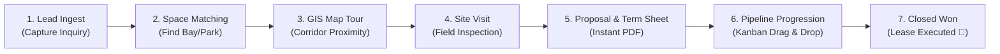

# 🏢 FAIRWAY CRM — Comprehensive Client Product Guide & End-to-End Walkthrough

> **Document Type:** Client Presentation & End-to-End User Manual  
> **Platform Name:** Fairway AI CRM — Industrial Warehouse Leasing & Commercial Operations Platform  
> **Target Audience:** Potential Clients, Enterprise Buyers, Leasing Directors, Warehouse Park Operators, Brokerage Heads  
> **Language:** English

---

## 🌟 Executive Summary: What is Fairway CRM?

**Fairway CRM** is an enterprise-grade commercial real estate management system built exclusively for **industrial warehouse developers, logistics park operators, 3PL providers, and commercial leasing brokers**.

### Why Generic CRMs Fail in Warehousing
Standard sales tools (like Salesforce, HubSpot, or Zoho) treat a deal like selling software or products. But leasing an industrial warehouse involves **high-value technical and physical requirements**:
- Can the flooring support a **7.5 Ton/m²** racking load (FM2 laser-screed concrete)?
- Is there a **12-meter clear height** for high-bay storage?
- Are there sufficient **hydraulic dock levelers** and truck apron space for 40-foot trailers?
- Is there **high-tension (HT) power load** for refrigeration or machinery?
- Does the client have a **corporate headquarters** linked to multiple manufacturing plants and regional distribution hubs?

**Fairway CRM solves all of this out-of-the-box**, enabling your team to close multi-crore leasing transactions faster, eliminate forgotten follow-ups, match requirements to warehouse bays instantly, and project an ultra-professional, institutional image to corporate tenants.

---

## 🔄 The Complete End-to-End Workflow: How Fairway CRM Works (From A to Z)

Here is the exact step-by-step lifecycle of how a deal travels through Fairway CRM from first contact to signed lease:

---

### Step 1: Login & Executive Dashboard Overview
**Where to go:** Login at `/login` $\to$ Redirects to `/dashboard`

1. **KPI Scorecard**: Upon logging in, leadership and leasing managers immediately see real-time figures:
   - **Active Inquiries**: Total live leasing leads currently being worked.
   - **Pipeline Valuation**: Total monthly & annual lease value represented by active deals.
   - **Conversion Rate**: Percentage of inquiries converted to executed leases.
   - **Overdue Follow-ups**: Zero-tolerance alert showing calls or tasks that need immediate attention.
2. **Deal Velocity & Pipeline Distribution**: Interactive charts showing deal value per corridor (Sanand, Dahej, Bhiwandi, Chakan) and volume by industry (Automotive, FMCG, Pharma, 3PL).
3. **Urgent Action Radar**: Displays today's scheduled follow-ups and site inspections so leasing managers never miss a client touchpoint.

---

### Step 2: Capturing a Commercial Requirement (New Inquiry)
**Where to go:** Top navigation `+ New Inquiry` button or `/inquiries/new`

When an inquiry arrives (via phone, broker, or website), the leasing agent captures the prospect's exact physical and financial specs:
1. **Company & Contact Information**:
   - Company Name (e.g. *Pareek Logistics*, *Tata AutoComp*, *Amazon India*).
   - Key Decision Maker, Designation, Mobile Number, and Email.
2. **Commercial Parameters**:
   - **Required Area**: Exact square footage required (e.g., *75,000 sq.ft*).
   - **Target Monthly Budget**: In Indian Rupees (e.g., *₹21,00,000 / month*).
   - **Target Location / Corridor**: Preferred industrial belt (e.g., *Sanand GIDC*, *Dahej PCPIR*).
3. **Technical & Structural Specifications**:
   - **Clear Height**: Eaves height needed (e.g., *12 meters*).
   - **Floor Load Capacity**: FM2 laser-screed concrete strength ($5 - 10\text{ Tons/m}^2$).
   - **Dock Count**: Number of loading bays and dock levelers needed.
   - **Power Sanction**: Electrical load in kVA for manufacturing or temperature control.
4. **Click "Create Inquiry"**: The system automatically assigns a unique, sequential tracking number (e.g., `INQ-6221`), stamps the audit trail, and adds the requirement to the live pipeline.

---

### Step 3: Managing Corporate Accounts & Multi-Facility Directories
**Where to go:** Left Sidebar `Companies` (`/companies`)

Large corporate tenants rarely operate from a single location. Fairway CRM organizes accounts hierarchically:
1. **Parent Account Dossier**: View the corporate entity, GSTIN, PAN, and primary account owner.
2. **Linked Facilities**: A single company dossier shows all their existing manufacturing units, regional distribution centers (RDCs), and mother warehouses across the country.
3. **Stakeholder Directory**: Multiple decision-makers are linked to the company (e.g., VP Supply Chain, Head of Real Estate, Plant Head, Procurement Lead) with one-click dial and email capabilities.

---

### Step 4: Automated Property Matching (Finding the Right Warehouse Bay)
**Where to go:** Inside the Inquiry Details page (`/inquiries/:id`) $\to$ `Property Matches` tab

Instead of thumbing through spreadsheets:
1. Fairway CRM's matching engine automatically evaluates your Grade-A warehouse inventory against the tenant's specifications.
2. It generates a **Compatibility Score** based on:
   - Available square footage fit.
   - Clear height sufficiency.
   - Floor load capacity.
   - Proximity to the requested corridor.
3. The leasing team can click **"Shortlist Property"** to prepare options for the client.

---

### Step 5: Visualizing Corridors on the GIS Interactive Map
**Where to go:** Left Sidebar `Corridor Map` (`/map`)

During client presentations or internal leasing reviews:
1. **Interactive Geographic Map**: Leaflet-powered GIS map plotting all your Grade-A logistics parks, land banks, and client facilities across India.
2. **One-Click Corridor Jump**: Click buttons like **Sanand**, **Dahej**, **Bhiwandi**, or **Chakan** to instantly zoom and center the map on specific clusters.
3. **Property Popovers**: Clicking any pin reveals the park name, available square footage, dock configuration, and rental rate card.

---

### Step 6: Visual Sales Pipeline (Kanban Drag & Drop)
**Where to go:** Left Sidebar `Sales Pipeline` (`/pipeline`)

This is the heartbeat of your daily leasing operations:
1. **Kanban Stage Columns**:
   - `Requirement Ingest` $\to$ `Property Matching` $\to$ `Site Visit Scheduled` $\to$ `Proposal / Term Sheet` $\to$ `Commercial Negotiation` $\to$ `Closed Won (Leased)`.
2. **Effortless Drag-and-Drop**:
   - Built on modern hardware-accelerated drag technology. Moving an opportunity between stages is as simple as dragging the card to the next column.
   - An intelligent 8px movement constraint allows clicking a card to view details while allowing smooth, intentional dragging.
3. **Stage Automation**:
   - Dropping a card into **Site Visit** prompts scheduling the inspection.
   - Dropping into **Closed Won** triggers a celebratory confetti milestone animation and prompts contract archiving.
   - Dropping into **Closed Lost** mandates selecting a lost reason (e.g., *Budget mismatch*, *Competitor chose another park*, *Timeline delayed*) to feed leadership churn analytics.

---

### Step 7: Scheduling & Executing Site Inspections (Site Visits)
**Where to go:** Left Sidebar `Site Visits` (`/site-visits`)

Physical warehouse inspections are critical for deal closure:
1. **Schedule Site Tours**: Assign an internal property manager or inspector to guide the prospective tenant.
2. **Attendee Management**: Record client representatives attending the tour.
3. **On-Site Findings Capture**: Post-visit, record tenant feedback (e.g., *“Client loved the clear height, requested 2 additional dock levelers and dedicated guard room”*).

---

### Step 8: Generating Commercial Proposals & PDF Term Sheets
**Where to go:** Left Sidebar `Proposals` (`/proposals`)

Say goodbye to manual Word document errors:
1. **Auto-Calculated Commercials**: Enter base rent ($₹/\text{sq.ft}$), CAM charges, security deposit months, and annual escalation percentage ($5\%$).
2. **Instant Financial Schedule**: The system automatically computes the monthly commitment, total security deposit, lock-in period, and possession date.
3. **One-Click PDF Generation**: Download a standardized, beautifully formatted commercial proposal PDF ready for client board approval.

---

### Step 9: Communication, Call Logs & Activity Audit Trails
**Where to go:** Left Sidebar `Calls` (`/calls`), `Communications` (`/communications`), and `Inquiry Timeline`

1. **Call Logger**: Log incoming or outgoing client calls with duration, outcome (*Interested*, *Call Back*, *Busy*), and notes.
2. **Activity Timeline**: An automated, tamper-proof activity stream on every lead showing who created the inquiry, who edited the budget, who moved the stage, and when proposals were dispatched.

---

### Step 10: Task Engine & Overdue SLA Radar
**Where to go:** Left Sidebar `Tasks` (`/tasks`)

1. **Scheduled Follow-ups**: Assign tasks to team members with exact due dates and priority tags (*High*, *Medium*, *Low*).
2. **Automated Overdue Alerts**: If a task passes its deadline, the system automatically flags it in bright red across the dashboard and pipeline cards, ensuring no corporate lead goes cold.
3. **PDF Task Summary**: Download an executive task sheet for morning sales standups.

---

### Step 11: Bulk Excel & CSV Data Migration Wizard
**Where to go:** Left Sidebar `Data Migration` (`/import`)

If the client has existing data in Excel or legacy spreadsheets:
1. **Universal Importer**: Upload `.xlsx` or `.csv` files containing hundreds of leads or properties.
2. **Smart Header Auto-Mapping**: Automatically aligns spreadsheet column headers (*Company Name*, *SqFt*, *Budget*, *Phone*) with database fields.
3. **Validation & Dry Run**: Validates data formatting before saving, ensuring zero duplicate or corrupted records enter your database.

---

### Step 12: Role-Based Access Control (RBAC) & Team Administration
**Where to go:** Left Sidebar `Settings` (`/settings`)

Keep your commercial data secure and compartmentalized:
1. **Pre-configured Roles**:
   - **Super Admin**: Complete control over accounts, settings, roles, and audit logs.
   - **Admin**: Operations management, property inventory, and reports.
   - **Sales Specialist**: Manages their own leads, pipeline, proposals, and tasks.
   - **Viewer**: Read-only oversight for investors, board members, or external auditors.
2. **Permission Matrix**: Fine-tune view, create, edit, and delete permissions for each module.
3. **Immutable Audit Logs**: View every user login, stage update, and data change with timestamp and IP address.

---

## 🖥️ Screen-by-Screen User Navigation Cheat Sheet

| Feature / Screen | Where to Click in UI | Primary Action |
| :--- | :--- | :--- |
| **Executive Dashboard** | Sidebar $\to$ `Dashboard` | Review revenue KPIs, pipeline health, and urgent tasks |
| **New Lead Capture** | Top Header $\to$ `+ New Inquiry` | Enter prospect square footage, budget, and structural specs |
| **Sales Pipeline** | Sidebar $\to$ `Pipeline` | Drag deal cards between stages; manage deal status |
| **Inquiry Dossier** | Click any Inquiry Card / Table Row | View linked client notes, property matches, and proposals |
| **Warehouse Inventory**| Sidebar $\to$ `Properties` | Check available square footage, dock count, and rate cards |
| **Corridor Map** | Sidebar $\to$ `Corridor Map` | Jump to Sanand, Dahej, or Bhiwandi clusters on GIS map |
| **Company Master** | Sidebar $\to$ `Companies` | Manage corporate parent accounts and linked plant facilities |
| **Site Tour Manager** | Sidebar $\to$ `Site Visits` | Schedule and record physical warehouse inspections |
| **Commercial Proposals**| Sidebar $\to$ `Proposals` | Generate branded leasing term sheets & download PDF |
| **Follow-up Tasks** | Sidebar $\to$ `Tasks` | Track overdue SLAs, schedule reminders, export PDF |
| **Data Migration** | Sidebar $\to$ `Import / Export` | Upload client Excel spreadsheets with auto-mapping |
| **Team & Security** | Sidebar $\to$ `Settings` | Manage user accounts, role permissions, and view audit logs |

---

## 🎤 Client Demo Script: How to Present Fairway CRM to a Client in 15 Minutes

When demonstrating Fairway CRM live to prospective clients or corporate leadership, follow this proven presentation flow:

### 1. The Hook (Minutes 0 - 2): "A CRM Built for Heavy Logistics"
> *"Good morning. Most CRMs were built to sell small SaaS subscriptions or consumer products. But in industrial real estate, a deal depends on clear heights, floor loads, power kVA, and dock configurations. Today, I'm showing you Fairway CRM—the first platform engineered specifically for Grade-A industrial logistics parks and commercial leasing operations."*

### 2. The Command Center (Minutes 2 - 4): The Executive Dashboard
> *Open `/dashboard`.*
> *"Here is your executive command center. In one glance, leadership sees total active pipeline valuation, deal conversion velocity, and critical overdue follow-ups. Nothing slips through the cracks."*

### 3. Capturing Demand & Auto-Matching (Minutes 4 - 7): Inquiries
> *Click `+ New Inquiry`, fill in a sample requirement (e.g. 80,000 sq.ft in Sanand with 12m clear height), and click Create.*
> *"Notice how we capture not just rent, but clear height, FM2 flooring, and dock levelers. Within seconds of creating this requirement, Fairway's matching engine pairs it with available warehouse bays in your inventory, showing your team exactly where to place the tenant."*

### 4. The Interactive Corridor Map (Minutes 7 - 9): GIS Mapping
> *Navigate to `/map` and click the "Sanand" corridor button.*
> *"Here is your GIS interactive corridor map. During tenant pitches, you can zoom right into your parks, show proximity to expressways and freight corridors, and display technical park specs on the fly."*

### 5. Driving Deals to Close (Minutes 9 - 12): The Kanban Pipeline
> *Navigate to `/pipeline`. Drag a card from 'Site Visit' to 'Proposal', then into 'Closed Won'.*
> *"Our pipeline gives leasing directors total visibility over every active deal. Cards drag seamlessly across custom stages. When a deal is won, your team celebrates—and if a deal is lost, Fairway requires capturing the reason so you understand your competition and pricing pressure."*

### 6. Automated Term Sheets & Enterprise Security (Minutes 12 - 15)
> *Show a generated Proposal with PDF download, then show `/settings` for Role-Based Access Control.*
> *"Finally, Fairway generates standardized commercial term sheets with instant PDF download, and protects your proprietary pricing data with bank-grade Role-Based Access Control and tamper-evident audit logs."*

---

## 💼 Core Business Benefits & Return on Investment (ROI)

1. **Shortened Deal Cycles**: Automated property matching and one-click term sheets reduce the time from first inquiry to site visit by **up to 60%**.
2. **Zero Opportunity Leakage**: Automated overdue warnings ensure prospective tenants are followed up systematically.
3. **Institutional Client Confidence**: Providing MNC tenants with instant technical matching, branded proposals, and clear corridor mapping positions your firm as an elite, institutional park operator.
4. **Data Ownership & Security**: Complete corporate control over proprietary rent rolls, tenant contacts, and negotiation histories with strict permission hierarchies.

---

*Proprietary & Confidential. © Fairway Logistics & Commercial Warehouse Operations.*
